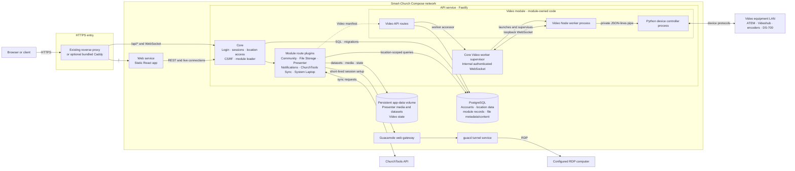

# Smart-Church server-side schema

This diagram shows the current production request path and server-side services. The bundled Caddy proxy is optional; it obtains HTTPS certificates automatically. An existing reverse proxy can use the same private web and API upstreams.

## Server responsibilities

- **Core API** validates the user session, selected location, permissions, CSRF token and request size. It loads API modules from each module's `manifest.json` and gives them shared database and location-access services.
- **Modules** own their route handlers and domain behavior. File Storage owns `/api/files` and its access grants; Presenter owns dataset and presentation media routes. Video owns its API routes and worker code; Core owns the supervisor and authenticated internal WebSocket used to launch and communicate with that worker.
- **PostgreSQL** is a separate service with a persistent database volume. The API applies checked-in SQL migrations during startup. File Storage's current records and file bytes remain in `stored_files` in PostgreSQL.
- **Persistent app data** is mounted at `/var/lib/smart-church` in the API container. Compose configures Presenter datasets/media and Video state there. The private Video equipment configuration is mounted read-only into the API container.
- **Network exposure** is through the selected reverse proxy. Compose binds the web and API upstream ports to loopback by default; PostgreSQL, Guacamole and `guacd` do not publish host ports in the base stack.

For the browser/client module boundary and ownership rules, see [Architecture](ARCHITECTURE.md). For deployment steps and proxy configuration, see [Container deployment](../deploy/README.md).
